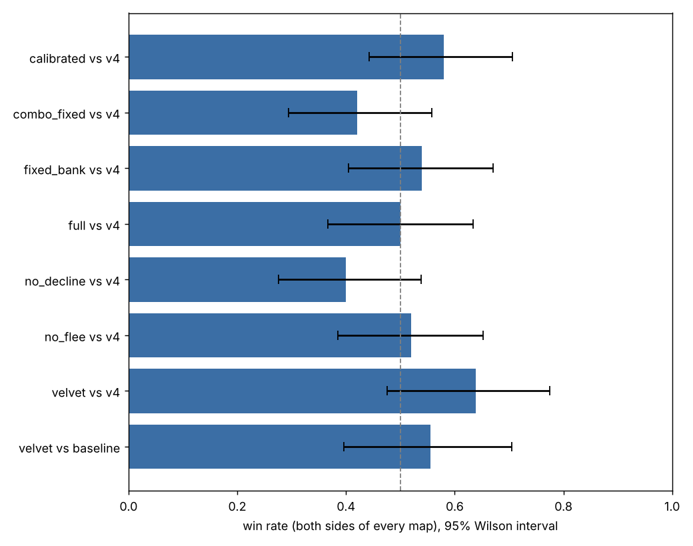
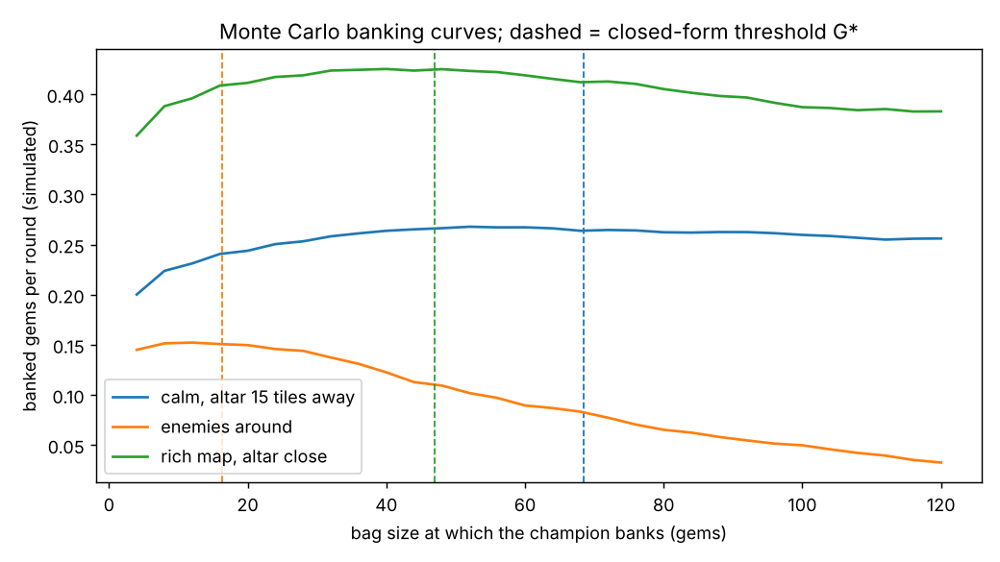

# Velvet Wolves: an AI team for Cambridge Battlecode 2026

A Python bot for [Cambridge Battlecode 2026a](https://2026a.battlecode.co.uk), a
student AI tournament. Each team writes code that controls three to five
champions. They clear monster camps, carry gems and bank them at altars; the
first team to bank 1,000 gems wins, otherwise the most gems after 2,000
rounds. Tournaments run on unseen maps, so everything here is judged
out-of-sample.

The project treats the bot like a trading system: **decision models with
closed-form or exact solutions, priors calibrated from data, and every
change backtested against a frozen baseline with confidence intervals**
before it ships.

| | |
|---|---|
| Bot | `bots/velvet/src` (runs in the official engine; submit with `cambc submit velvet`) |
| Frozen baseline | `bots/baseline` (v4) |
| Research | `research/` (backtest engine, statistics, tuning, Monte Carlo, calibration, tests) |

## Architecture

```
bots/velvet/src/
  main.py      engine loop: draft or play, never let an error skip end_turn
  draft.py     champion picks from a tuned preference order
  bot.py       per-champion controller: shop > fight > survive > bank > farm
  world.py     map caches, belief state for every camp group, 8-byte team protocol
  nav.py       shortest paths over a per-turn occupancy map, danger avoidance
  combat.py    casting, attacks, healing; the fight-or-decline decision
  economy.py   emblem builds; risk-adjusted banking with online estimates
  models.py    the maths, no engine calls: unit-tested offline
  params.py    every tunable number, rewritten by research/tune.py
```

Each champion runs its own copy of the bot. Vision is not shared, so each
copy keeps its own belief state: camp group alive, with estimated health;
reward waiting; or respawning, with an expected return round. The team
coordinates through the 8 bytes of shared memory the game allows. Seven bytes
hold each champion's claimed camp group and one holds the squad target the
leader has chosen. On a small camp, the lower slot keeps a contested claim,
which stops teammates flip-flopping.

The engine meters compute ("fuel", 2.5M units per Python turn). The first
working version spent most of it re-reading camps one by one, and stalled
mid-turn on about half its turns. Rewriting knowledge refresh as native
bitboard operations cut a typical turn from about 1.3M to about 0.37M fuel.

## The models (`models.py`)

**1. Kill order is a scheduling problem: Smith's rule.**
Every monster in a camp group hits each round until it dies, so the damage
the team takes is `sum(strength_i x finish_time_i)`. Killing monsters in
descending `strength / health` order minimises it. This is the
weighted-completion-time result, proved by swapping adjacent pairs.
`test_smith_rule_is_optimal_against_every_permutation` checks it against brute
force over every permutation.

**2. Target choice is a rate.**
A solo target is scored as `value / (travel + kill + capture + healing trips)`.
Big groups go to the whole team. There, the leader charges each expected death
its 60-round respawn plus the walk back, so a camp that costs a death can
still be worth taking.

**3. Banking is inventory under risk.**
Carried gems are lost on death, and banking costs a round trip of `T` rounds.
With income `r` gems per round and death hazard `λ`, banking every `G` gems
earns

```
f(G) = (G - aG²) / (G/r + T),   a = λ / 2r
```

Setting `f'(G) = 0` gives the positive root

```
G* = r · (√(a²T² + aT/r) − aT) / a
```

It behaves as it should: more danger means bank sooner, a longer walk means
bank later, and no danger means never pay for the trip.
- `λ` is a Gamma-Poisson posterior per champion, one for calm play and one for
  when enemies have been seen recently.
- `r` is an EWMA of the champion's own gem income.

**4. Team fights use Lanchester's square law.**
A side's fighting strength is `(total damage rate) × (total health)`. We fight
when our ratio clears a tuned threshold. Once an enemy can reach us we fight
anyway, because everyone moves at the same speed and recall breaks on damage.
For close 1v1 calls, `duel_win_probability` computes the exact win
probability, averaged over the enemy's unknown ability cooldown. We focus the
enemy with the best reward per round of kill time, which is often the one
carrying gems, since a kill takes the whole bag.

## Research method

- **Train/test split.** The 128 published maps are split 74/54 by a hash of their name. Tuning
  uses training maps only, and results are confirmed on held-out maps,
  matching the tournament's unseen maps.
- **Paired games.** Every map is played twice with sides swapped, which
  cancels first-mover and spawn asymmetry.
- **Statistics** (`stats.py`):
  - win rate with a Wilson 95% interval
  - paired bootstrap interval on the per-map gem margin
  - exact sign test
  - implied Elo gap
- **Ablation** (`tune.py`): switch one model off at a time and measure what it
  was worth.

## Results

Every row is two games per map, one on each side. Raw per-game data is in
`research/results/*.csv`.

### 1. Ablation: what each model is worth (training maps, 50 games each, against v4)

| Variant | Win rate [95% CI] | Gem margin per map [95% CI] | K/D |
|---|---|---|---|
| full model | 50% [37–63] | −4 [−130, +124] | 0.73 |
| fleeing off | 52% [39–65] | +48 [−86, +182] | 0.76 |
| **fight-decline model off** | **40% [28–54]** | **−182 [−317, −51]** | **0.48** |
| hand-set banking rules | 54% [40–67] | +90 [−29, +206] | 0.78 |

The Lanchester/duel decline model is the one change whose effect clears
zero. Without it the bot takes losing fights, its K/D halves, and it loses
182 gems a map. Fleeing does not pay. Everyone moves at the same speed and
damage cancels recall, so a fleeing champion gets hit for free. The bot now
fights back instead (`flee_enabled: False`).

### 2. Calibration: replacing guessed priors with measured ones

`research/calibrate.py` pooled 396 champion-games (3,159 deaths over 514k
alive rounds):

- **Death hazard:** 0.0061 per round [95% CI 0.0059–0.0064], a mean life of
  about 160 rounds.
- **Gem income:** 0.11 per alive champion-round.

The original income prior of 0.35 was three times too optimistic, and the
calm hazard was half the real one. Both mistakes made the bot carry gems too
long. With the measured priors:

| Variant (training maps, 50 games each) | Win rate [95% CI] | Gem margin per map [95% CI] |
|---|---|---|
| **calibrated priors, fleeing off (shipped)** | **58% [44–71]** | +41 [−91, +166] |
| hand-set banking, fleeing off | 42% [29–56] | −43 [−190, +108] |

### 3. Out-of-sample confirmation (held-out maps the tuning never saw)

| Bot | Win rate [95% CI] | Gem margin per map [95% CI] |
|---|---|---|
| shipped velvet vs baseline (v4) | 55.6% [40–71] | +32 [−68, +147] |
| first modular velvet vs v4 | 63.9% [48–78] | +93 [−42, +227] |
| v4 vs the starter bot (earlier) | 22/24 wins | 890 vs 241 gems per game |



**How to read this.** Against the starter bot the gap is huge. Against our
own strong baseline the models give a consistent edge: a positive mean
margin in every held-out test. The intervals still cross zero, though, and
proving a 5–10 point edge would need several hundred games. The one effect
that is clearly established is the fight-decline model. The banking model
is supported mainly by the Monte Carlo below and by calibration. The
win-rate evidence for it is weaker.

### 4. Monte Carlo check of the banking formula

`research/montecarlo_banking.py` simulates 400k rounds per threshold, with
lumpy camp payouts, Poisson deaths and fixed trip times. It then compares the
best simulated threshold with the closed-form `G*`:

| Scenario | Closed-form G* | Best simulated G | Income lost by using G* |
|---|---|---|---|
| calm, altar 15 tiles away | 68.5 | 52 | 1.5% |
| enemies around | 16.4 | 12 | 1.0% |
| rich map, altar close | 46.9 | 40 | 0.0% |

The income curve is flat near its optimum, so the formula's gap to the
simulated best costs at most 1.5% of income. That makes it safe to use the
formula in place of simulation inside the bot. The simulation would not fit
in the bot's compute budget.



## Reproduce

```bash
pip install cambc numpy matplotlib pytest
cambc init --yes .                                   # SDK and the published map pool
python -m pytest research/tests -q                   # model unit tests
python research/montecarlo_banking.py                # banking Monte Carlo + chart
python research/arena.py velvet baseline --maps test --out results/velvet_vs_baseline_test.csv
python research/stats.py research/results/*.csv      # confidence intervals for every backtest
python research/tune.py --baseline baseline --maps train_quick --variant my_try retreat_health=0.3
python research/calibrate.py velvet                  # hazard and income priors from backtest data
cambc run velvet baseline --map maps/00ambush.map26a --view   # watch a match
```

## Limitations

- The only opponents available offline are the starter bot and earlier
  versions of this one. Top ladder teams are likely stronger, and
  their strategies are unknown until we see their matches.
- Effects under about 10 percentage points need more games than a laptop runs
  overnight. Intervals are reported so that small differences are not
  over-read.
- Python's fuel budget rules out Monte Carlo inside the bot: the simulations
  run offline, and the bot uses the closed forms they validate.
